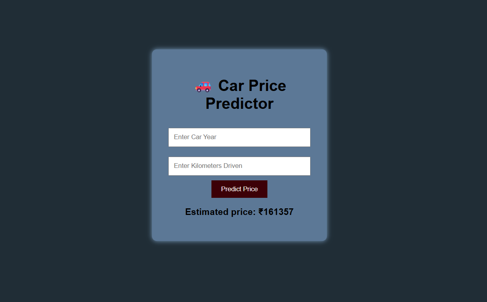

# Car Price Predictor

A Flask web app that estimates a used car's selling price from its year and kilometres driven, using a Linear Regression model trained with scikit-learn.



## Tools
Python, Flask, pandas, scikit-learn (Linear Regression), HTML, CSS

## How it works
1. The user enters the car's year and kilometres driven in a form.
2. Flask sends the values to a Linear Regression model trained on `car_datas.csv`.
3. The predicted price is shown on the same page.

## Run locally
```bash
pip install -r requirements.txt
python app.py
```
Then open http://127.0.0.1:5000 in your browser.

## Limitations and future work
The model uses only two features, so predictions are approximate. Adding brand, fuel type, and owner count would improve accuracy.
